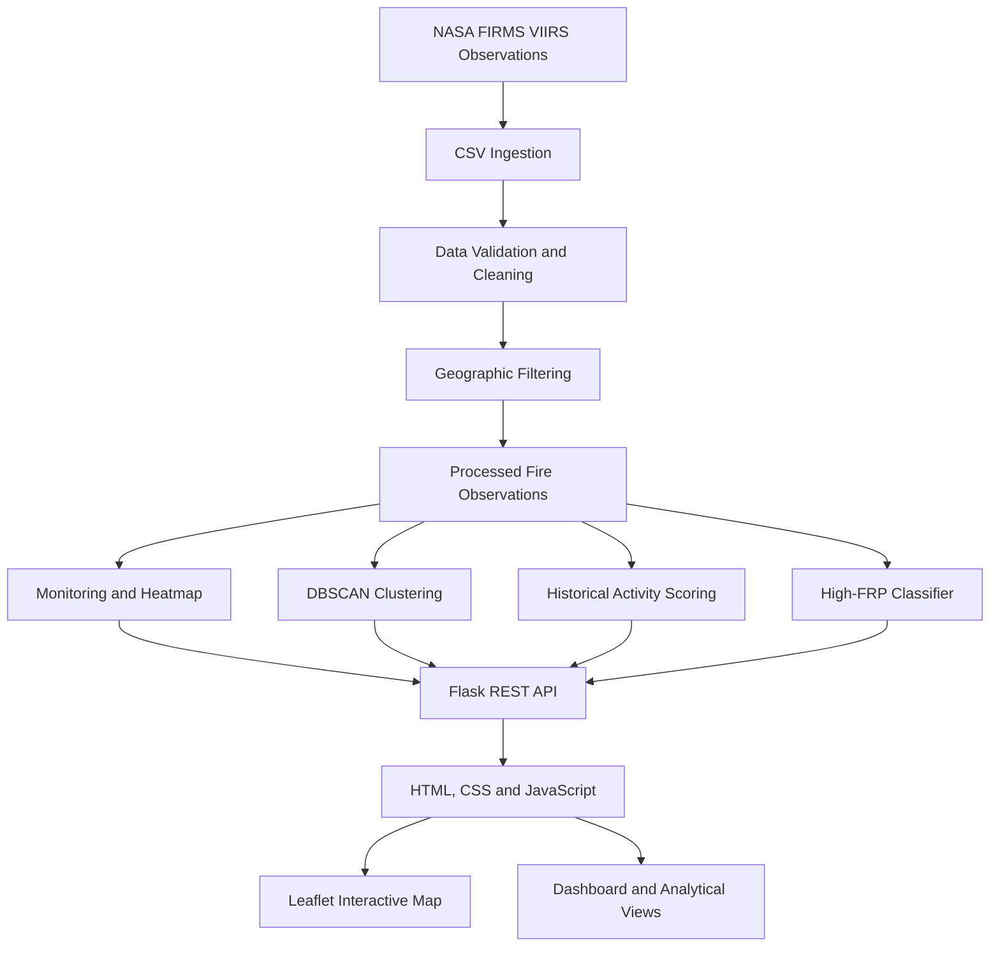

#  TerraMind AI
### Wildfire Intelligence & Satellite Fire Detection Platform

**Transforming satellite observations into actionable geospatial wildfire intelligence.**

TerraMind AI is a geospatial artificial intelligence platform designed to process, analyze, cluster, and classify satellite-based fire detections across the Indian subcontinent. By combining NASA FIRMS VIIRS observations, geospatial data engineering, unsupervised machine learning, historical activity scoring, and supervised classification, TerraMind AI converts large volumes of raw satellite data into an interactive wildfire intelligence dashboard.

The platform is designed to help users explore fire activity patterns, identify spatially concentrated detections, prioritize historically active geographical regions, and screen observed fire detections for high Fire Radiative Power (FRP).


<p align="center">
  <strong>Satellite Data • Geospatial Analytics • Machine Learning • Wildfire Intelligence</strong>
</p>

---

## 📌 Table of Contents

- [Project Overview](#-project-overview)
- [Problem Statement](#-problem-statement)
- [Our Solution](#-our-solution)
- [Key Features](#-key-features)
- [Data Source](#-data-source)
- [System Architecture](#-system-architecture)
- [Technology Stack](#-technology-stack)
- [Core Methodology](#-core-methodology)
  - [Data Preprocessing](#1-data-ingestion-and-preprocessing)
  - [Geospatial Monitoring](#2-geospatial-monitoring-and-heatmap-aggregation)
  - [DBSCAN Clustering](#3-spatial-clustering-using-dbscan)
  - [Historical Activity Scoring](#4-historical-fire-activity-scoring)
  - [High-FRP Classification](#5-supervised-high-frp-classification)
- [Application Modules](#-application-modules)
- [API Reference](#-api-reference)
- [Project Structure](#-project-structure)
- [Installation and Setup](#-installation-and-setup)
- [Running the Application](#-running-the-application)
- [Example Workflow](#-example-workflow)
- [Performance and Optimization](#-performance-and-optimization)
- [Scientific Limitations and Responsible Use](#-scientific-limitations-and-responsible-use)
- [Future Scope](#-future-scope)
- [Troubleshooting](#-troubleshooting)
- [Contributing](#-contributing)
- [Acknowledgements](#-acknowledgements)
- [License](#-license)

---

## 🚀 Project Overview

Wildfires and other biomass-burning events produce thermal anomalies that can be detected by Earth-observation satellites. However, raw satellite datasets contain large numbers of individual observations that can be difficult to interpret without appropriate data processing and geospatial analysis.

TerraMind AI provides an integrated workflow for turning these observations into structured information through data cleaning, spatial aggregation, density-based clustering, historical activity analysis, and machine learning classification.

### Project Highlights

| Component | Description |
|---|---|
| Project domain | Geospatial AI and environmental monitoring |
| Geographic coverage | Indian subcontinent study region |
| Data source | NASA Fire Information for Resource Management System (FIRMS) |
| Satellite instrument | VIIRS aboard Suomi-NPP |
| Dataset scale | More than 1.065 million historical observations |
| Backend | Python and Flask |
| Data processing | Pandas and NumPy |
| Clustering algorithm | DBSCAN with Haversine distance |
| Machine learning | Supervised high-FRP classification |
| Visualization | Leaflet.js and OpenStreetMap |
| Interface | HTML, CSS and JavaScript |

### Geographic Coverage

The configured geographic bounding box is:

- **Latitude:** 6°N to 38°N
- **Longitude:** 65°E to 100°E

These bounds define the project's study region. They should not be interpreted as an exact representation of India's international borders.

---

## 🎯 Problem Statement

Wildfire monitoring involves substantial geographical, temporal, and computational challenges.

1. **Large-scale satellite data:** Millions of observations can be difficult to inspect manually.
2. **Fragmented detections:** Individual coordinates do not immediately reveal spatially concentrated fire activity.
3. **Geographic complexity:** Fire detections occur across different terrains, climates, and ecological regions.
4. **Intensity variation:** A large number of detections does not necessarily indicate the most intense burning activity.
5. **Historical analysis:** Researchers need ways to compare fire activity across geographical areas and time periods.
6. **Decision support:** Users need interpretable visualizations and screening tools rather than raw CSV files alone.

### Objective

To develop a geospatial intelligence platform that organizes satellite fire detections into meaningful spatial groups, summarizes historical activity, and supports the screening of observed detections using machine learning.

---

## 💡 Our Solution

TerraMind AI combines data engineering, geospatial analytics, and machine learning in a single web application.

The platform is organized around four principal analytical components:

1. **Geospatial Monitoring:** Summarizes satellite detections through key metrics, geographical density grids, and temporal distributions.
2. **DBSCAN Clustering:** Groups nearby observations into spatial clusters and identifies isolated detections as noise.
3. **Historical Activity Scoring:** Ranks geographical grid cells using detection frequency, thermal intensity, and satellite confidence.
4. **High-FRP Classification:** Applies a supervised machine learning model to estimate whether an existing detection belongs to a configured high-FRP category.

The resulting information is presented through an interactive dashboard to support exploration and analysis.

---

## ✨ Key Features

### 1. Satellite Data Processing
- Processes large historical VIIRS datasets.
- Validates geographical coordinates and required attributes.
- Handles numeric conversion and missing values.
- Supports date-based filtering and geographical analysis.

### 2. Interactive Geospatial Dashboard
- Displays overall detection statistics.
- Summarizes fire radiative power and confidence levels.
- Aggregates observations into geographical grid cells.
- Supports exploration of spatial and temporal patterns.

### 3. Density-Based Fire Clustering
- Uses DBSCAN to identify spatial concentrations.
- Applies Haversine distance to account for Earth's curvature.
- Supports clustering without requiring a predefined number of clusters.
- Separates isolated observations from density-connected groups.

### 4. Historical Fire Activity Index
- Combines observation frequency, mean FRP, and high-confidence detection proportions.
- Applies percentile-based normalization.
- Produces a relative activity score for comparing geographical cells.

### 5. Machine Learning Classification
- Screens observed detections for high FRP.
- Uses satellite-derived and temporal features where supported by the trained model.
- Applies a configurable classification threshold.
- Returns a predicted class and associated probability when the model is available.

### 6. REST API Integration
- Provides endpoints for summary statistics, clustering, activity analysis, hotspot ranking, and prediction.
- Separates analytical processing from frontend visualization.

### 7. Responsible Interpretation
- Distinguishes spatial clustering from future fire forecasting.
- Treats DBSCAN noise as a spatial classification rather than proof of an invalid observation.
- Presents FRP classification as an assessment of an observed detection, not a prediction of future fire spread.

---

## 🛰️ Data Source

TerraMind AI uses satellite fire-detection observations from NASA's Fire Information for Resource Management System.

**Primary data source:** NASA FIRMS

Website: https://firms.modaps.eosdis.nasa.gov/

### Satellite Instrument

The project uses observations from the Visible Infrared Imaging Radiometer Suite (VIIRS) aboard the Suomi National Polar-orbiting Partnership (Suomi-NPP) satellite.

The VIIRS 375 m active-fire product provides nominal spatial resolution at nadir, allowing relatively detailed detection of thermal anomalies.

### Dataset Summary

| Attribute | Description |
|---|---|
| Provider | NASA FIRMS |
| Instrument | VIIRS |
| Satellite | Suomi-NPP |
| Collection | Collection 2 |
| Dataset type | Historical active-fire detections |
| Approximate observations | 1.065 million |
| File format | CSV |
| Geographic filter | Configured India-region bounding box |

The exact record count and date coverage should be verified against the dataset included in the repository.

### Important Dataset Attributes

| Attribute | Purpose |
|---|---|
| `latitude` | Observation latitude |
| `longitude` | Observation longitude |
| `acq_date` | Acquisition date |
| `acq_time` | Acquisition time |
| `brightness` | Brightness-temperature measurement supplied by the product |
| `bright_t31` | Thermal infrared brightness-temperature field |
| `frp` | Fire Radiative Power, generally expressed in megawatts |
| `confidence` | Detection confidence category |
| `daynight` | Daytime or nighttime observation |
| `scan` | Scan-direction footprint dimension |
| `track` | Along-track footprint dimension |

The available fields depend on the exact FIRMS product and CSV schema. The application should validate the expected columns before processing.

### Understanding Fire Radiative Power

Fire Radiative Power (FRP) estimates the rate at which radiant energy is emitted by a detected fire. It is an important indicator of fire intensity and can support analysis of burning activity.

However, FRP is not equivalent to total burned area, fire duration, or a direct measurement of future danger. Satellite detection limitations and observation conditions must also be considered.

---

## 🏗️ System Architecture

TerraMind AI follows a data-processing and API-driven web application architecture.



### Processing Workflow

1. Load the available satellite observation files.
2. Validate the required fields and convert data types.
3. Remove or handle invalid spatial and analytical values.
4. Restrict the observations to the configured study region.
5. Generate spatial aggregates and density-based clusters.
6. Calculate historical activity scores.
7. Apply the trained classifier when its model artifact is available.
8. Return results through Flask endpoints.
9. Display the results in the interactive web interface.

---

## 🧰 Technology Stack

| Technology | Role |
|---|---|
| Python | Core application and data processing |
| Flask | Web server and REST API |
| Pandas | CSV ingestion and tabular processing |
| NumPy | Numerical calculations and vectorized operations |
| Scikit-learn | DBSCAN and supervised machine learning |
| BallTree | Efficient spatial-neighbour search |
| Joblib | Serialization and loading of trained model artifacts |
| HTML5 | Page structure |
| CSS3 | Responsive interface styling |
| JavaScript | Frontend logic and API communication |
| Leaflet.js | Interactive maps |
| OpenStreetMap | Map tile source |

---

## 🧠 Core Methodology

### 1. Data Ingestion and Preprocessing

The preprocessing stage prepares satellite observations for spatial analysis.

Typical operations include:

- Loading CSV files using Pandas.
- Validating required column names.
- Converting latitude, longitude, FRP, and other numerical fields.
- Parsing acquisition dates and times.
- Handling missing or invalid values.
- Filtering observations by geographic boundaries.
- Preparing consistent fields for downstream analytical modules.

Invalid coordinates or missing values in required fields can prevent an observation from being used by a particular module.

**Purpose:** Improve data consistency and ensure that downstream analysis uses valid observations.

### 2. Geospatial Monitoring and Heatmap Aggregation

The monitoring module summarizes a large dataset into a manageable number of geographical aggregates.

A geographical grid allows observations to be grouped according to their approximate spatial location.

For a grid resolution of 0.1 degrees, the approximate north-south spacing is 11 km. The east-west distance varies with latitude.

The dashboard can summarize:

- Total observations.
- High-confidence detections.
- Mean and median FRP.
- Daytime versus nighttime observations.
- Confidence distributions.
- Daily or periodic detection trends.
- Geographical concentrations of fire activity.

**Purpose:** Provide a high-level view of spatial distribution and historical observation patterns without rendering every raw record individually.

### 3. Spatial Clustering Using DBSCAN

TerraMind AI uses DBSCAN (Density-Based Spatial Clustering of Applications with Noise) to identify groups of geographically close fire detections.

Unlike K-Means, DBSCAN does not require the number of clusters to be specified in advance. It can also classify observations that do not meet the required density conditions as noise.

#### Why DBSCAN?

- The number of spatial groups is not known beforehand.
- Fire detections can form irregular geographical patterns.
- Isolated detections should not automatically be assigned to a dense group.
- Density-based grouping is suitable for exploratory spatial analysis.

#### Haversine Distance

Latitude and longitude describe positions on Earth's surface. Euclidean distance applied directly to degree coordinates does not correctly represent geographical distances.

The Haversine metric estimates great-circle distance on a spherical Earth.

For the documented configuration:

| Parameter | Value |
|---|---:|
| Earth radius | 6,371.0088 km |
| Cluster radius | 5 km |
| DBSCAN `eps` | Approximately 0.0007848 radians |
| `min_samples` | 10 observations |
| Maximum clustering sample | 20,000 observations |
| Sampling seed | 42 |

The coordinate conversion is:

\[
\text{latitude}_{rad} = \text{latitude}_{deg}\frac{\pi}{180}
\]

\[
\text{longitude}_{rad} = \text{longitude}_{deg}\frac{\pi}{180}
\]

The DBSCAN radius is:

\[
\epsilon = \frac{5}{6371.0088}
\]

This is approximately 0.0007848 radians.

#### Cluster Interpretation

- **Core observations:** Meet the density requirement.
- **Border observations:** Fall within the neighbourhood of a density-connected cluster but do not independently meet the core requirement.
- **Noise observations:** Do not belong to a discovered cluster under the configured parameters.

Cluster size and colour categories, if shown in the interface, are visualization conventions.

**Important:** A DBSCAN cluster indicates a spatial concentration of satellite detections. It does not independently establish that every point belongs to the same physical fire or that the fire is spreading.

### 4. Historical Fire Activity Scoring

The activity-scoring module combines several characteristics of observations within a geographical grid cell.

The documented scoring formulation is:

\[
S_{\text{activity}} =
0.50S_{\text{freq}} +
0.30S_{\text{frp}} +
0.20S_{\text{conf}}
\]

Where:

- \(S_{\text{freq}}\) represents normalized detection frequency.
- \(S_{\text{frp}}\) represents normalized mean FRP.
- \(S_{\text{conf}}\) represents the proportion of high-confidence detections.

The component scores are calculated as follows.

**Frequency score**

\[
S_{\text{freq}} =
\min\left(100,
\frac{N}{P_{95}(N)}\times100\right)
\]

Here, \(N\) is the cell's detection count and \(P_{95}(N)\) is the 95th percentile of detection counts across cells.

**Intensity score**

\[
S_{\text{frp}} =
\min\left(100,
\frac{\overline{\text{FRP}}}
{P_{95}(\overline{\text{FRP}})}\times100\right)
\]

**Confidence score**

\[
S_{\text{conf}} =
\frac{N_{\text{high-confidence}}}{N_{\text{total}}}\times100
\]

The documented geographical grid resolution is 0.25° × 0.25°.

Percentile-based normalization reduces the influence of exceptionally large values and helps differentiate cells across a highly skewed distribution.

The project also documents a separate logarithmic hotspot-scoring formulation for its hotspot endpoint. The exact implementation should be consulted when comparing the two scoring systems.

**Purpose:** Rank observed historical activity, not calculate a calibrated probability that a future wildfire will occur.

### 5. Supervised High-FRP Classification

The classifier is designed to screen an existing satellite detection for membership in a high-FRP category.

FRP is the target variable used to define the classification label. The documented reference threshold is 50 MW:

\[
y =
\begin{cases}
1, & \text{if FRP} \geq 50\text{ MW}\\
0, & \text{if FRP} < 50\text{ MW}
\end{cases}
\]

The model can return a class prediction and a probability estimate if the trained model and its preprocessing pipeline are correctly installed.

#### Feature Engineering

The documented feature-engineering design includes:

| Feature | Description |
|---|---|
| Brightness difference | Difference between `brightness` and `bright_t31` |
| Time encoding | Sine and cosine representations of acquisition hour |
| Seasonal encoding | Sine and cosine representations of month |
| Annual encoding | Sine and cosine representations of day of year |
| Spatial coordinates | Latitude and longitude |
| Sensor geometry | Scan and track attributes |
| Detection context | Supported categorical fields such as confidence and day/night |

Cyclical features can be expressed as:

\[
x_{\sin}=\sin\left(\frac{2\pi t}{T}\right)
\]

\[
x_{\cos}=\cos\left(\frac{2\pi t}{T}\right)
\]

These representations preserve the circular relationship between values such as 23:00 and 00:00, or December and January.

The precise feature list and estimator must match the model artifact used by the application.

#### Classification Threshold

The documented operational decision threshold is:

\[
\tau = 0.15
\]

The predicted class is positive when the model's high-FRP probability reaches the configured threshold.

A lower threshold can increase sensitivity to potential high-FRP detections, but it can also increase false positives. The threshold should be evaluated against validation data using precision, recall, F1-score, a confusion matrix, and, where appropriate, precision-recall analysis.

**Scientific limitation:** A probability estimate is not automatically a calibrated real-world risk probability. The classifier screens observed detections; it does not forecast where or when new wildfires will start.

---

## 📊 Application Modules

The documented application design contains the following modules.

### Module 1 — Overview Dashboard

**Route:** `/`

Provides a summary of the available dataset through key metrics, spatial density visualization, and temporal or confidence distributions.

### Module 2 — Spatial Clustering

**Route:** `/clustering`

Runs DBSCAN on the applicable observation set and displays discovered clusters and isolated observations.

### Module 3 — Historical Fire Activity

**Route:** `/activity`

Displays ranked geographical cells and their relative activity scores.

### Module 4 — High-FRP Classifier

**Route:** `/classifier`

Provides an interface for submitting supported satellite observation features and viewing the model's classification result.

The availability of individual routes depends on the current application code and configuration.

---

## 🔌 API Reference

The following endpoints are part of the documented API design.

| Method | Endpoint | Purpose |
|---|---|---|
| GET | `/api/summary` | Summary metrics and aggregated spatial or temporal data |
| GET | `/api/clusters` | Spatial clustering results |
| GET | `/api/activity` | Historical activity scores |
| GET | `/api/hotspots` | Ranked geographical hotspots |
| POST | `/api/predict` | High-FRP classification |

### Example: Request a Summary

```http
GET /api/summary
```

The response schema depends on the current implementation.

### Example: Run Spatial Clustering

```http
GET /api/clusters
```

The endpoint returns clustering results when the relevant route and data-processing logic are available.

### Example: Request a Classification

```http
POST /api/predict
Content-Type: application/json
```

Illustrative request payload:

```json
{
  "latitude": 20.5937,
  "longitude": 78.9629,
  "brightness": 360,
  "bright_t31": 295,
  "scan": 0.5,
  "track": 0.5,
  "confidence": "h",
  "daynight": "D",
  "acq_date": "2026-04-15",
  "acq_time": "0830"
}
```

This payload illustrates the documented input fields. The actual request schema, accepted categorical values, numeric validation, and date/time formats must match the application's implementation.

An illustrative response could contain:

```json
{
  "success": true,
  "prediction": 1,
  "probability": 0.428,
  "high_frp_probability": 0.428,
  "threshold_used": 0.15,
  "frp_threshold_mw": 50.0,
  "label": "High FRP"
}
```

**Note:** This is an example of the documented response format, not a verified live model prediction.

---

## 📁 Project Structure

The repository contains the project assets and dataset. The following is a suggested logical structure; retain your actual filenames and directories when documenting the implementation.

```text
TerraMind-AI/
│
├── Dataset/
│   └── fire_archive_SV-C2_820222.csv
│
├── static/
│   ├── css/
│   ├── js/
│   └── images/
│
├── templates/
│   └── index.html
│
├── models/
│   └── high_frp_classifier.joblib
│
├── app.py
├── requirements.txt
├── .gitignore
├── LOGO.png
├── README.md
└── TerraMind_AI_PPT_Presentation_Document.md
```

The `static/`, `templates/`, `models/`, `app.py`, and `requirements.txt` entries describe a suggested organization. Adjust the tree to match the files actually present in the repository.

The trained model artifact is needed only if the classification module loads a serialized model from that location.

---

## ⚙️ Installation and Setup

### Prerequisites

Install the following before running the project:

- Python 3.10 or a compatible version supported by the project's dependencies.
- Git.
- A modern web browser.
- Sufficient RAM and disk space for the large CSV dataset and analytical operations.

### Step 1 — Clone the Repository

```bash
git clone https://github.com/sanketgudade/TerraMind-AI.git
cd TerraMind-AI
```

### Step 2 — Create a Virtual Environment

**Windows PowerShell**

```powershell
python -m venv .venv
.\.venv\Scripts\Activate.ps1
```

If PowerShell blocks script execution, use a process-scoped policy for the current terminal:

```powershell
Set-ExecutionPolicy -Scope Process -ExecutionPolicy RemoteSigned
.\.venv\Scripts\Activate.ps1
```

**Linux or macOS**

```bash
python3 -m venv .venv
source .venv/bin/activate
```

### Step 3 — Install Dependencies

If the repository contains a `requirements.txt` file:

```bash
python -m pip install --upgrade pip
pip install -r requirements.txt
```

If the dependency file is not present, install the packages required by the current implementation. The documented core dependencies include:

```bash
pip install flask pandas numpy scikit-learn joblib
```

Install any additional packages imported by the source code.

### Step 4 — Add the Dataset

Place the NASA FIRMS archive CSV at the path expected by the application.

For the documented dataset, the intended filename is:

```text
Dataset/fire_archive_SV-C2_820222.csv
```

If the dataset is not distributed with the repository, download the appropriate product from the official NASA FIRMS website and place it in the expected directory.

Verify the filename and column schema before running the application.

### Step 5 — Verify the Installation

```powershell
python -c "import flask, pandas, numpy, sklearn, joblib; print('Core dependencies imported successfully')"
```

If this command succeeds, the main Python dependencies are available in the active environment.

---

## ▶️ Running the Application

From the project root, with the virtual environment activated:

```powershell
python app.py
```

If the application uses a different entry point, run the command specified by that source file's instructions.

Open the local address printed in the terminal. For example:

```text
http://127.0.0.1:5000
```

The port depends on the application's Flask configuration. If port 5000 is occupied, configure a free port and use the resulting address.

### Verify the Application

1. Confirm that the Flask server starts without errors.
2. Check that the expected dataset file can be loaded.
3. Open the dashboard in a browser.
4. Confirm that the summary metrics appear.
5. Test clustering and activity analysis.
6. Test classification only if the trained model artifact is available.
7. Inspect the browser console and terminal if any API request fails.

---

## 🔬 Example Workflow

A typical analytical workflow using TerraMind AI is:

1. **Load observations:** Ingest historical satellite detection records.
2. **Validate the data:** Check required attributes and coordinate ranges.
3. **Explore the overview:** Examine aggregate detection counts and geographical distributions.
4. **Identify clusters:** Run DBSCAN to find spatially concentrated detections.
5. **Rank activity:** Compare geographical cells using historical activity scores.
6. **Screen individual detections:** Submit valid observations to the high-FRP classifier.
7. **Interpret the results:** Use the dashboard to investigate patterns and identify areas for further assessment.

This workflow supports exploratory analysis and screening. It should not be treated as an autonomous emergency-response decision system.

---

## ⚡ Performance and Optimization

The project design incorporates several techniques intended to keep processing manageable for large satellite datasets.

- **Vectorized operations:** Pandas and NumPy support efficient tabular and numerical processing.
- **Spatial indexing:** BallTree-based neighbour search supports efficient geographical clustering.
- **Bounded clustering sample:** The documented DBSCAN configuration limits the clustering input to a maximum of 20,000 sampled points.
- **Aggregated visualization:** Grid-based summaries reduce the number of geographical features sent to the browser.
- **Serialized models:** Joblib can load a trained model at startup rather than reloading it for every prediction.
- **Noise-point limits:** Capping the number of returned noise observations can reduce frontend rendering overhead.

Actual execution time and memory usage depend on hardware, dataset size, filters, software versions, and implementation details. Benchmark claims should be measured on the target environment.

---

## ⚠️ Scientific Limitations and Responsible Use

TerraMind AI is an analytical and decision-support prototype. Its outputs must be interpreted in the context of satellite data limitations and model validation.

### Satellite Observations Are Not Ground Truth

Active-fire detections are satellite observations of thermal anomalies. Detection quality may vary with cloud cover, observation geometry, pixel footprint, and other conditions.

### Clusters Are Not Necessarily Individual Fires

Spatial proximity does not prove that detections belong to the same physical fire. A cluster may include separate burning sources or other thermal anomalies.

### Noise Does Not Mean Invalid Data

A DBSCAN noise label indicates that a detection does not satisfy the configured spatial density conditions. It does not establish that the observation is false.

### Historical Activity Is Not a Future Risk Forecast

Historical detection frequency, mean FRP, and confidence scores describe the available observations. They do not by themselves estimate future ignition probability or fire propagation.

### Classification Requires Validation

A classifier's reliability depends on training data, target definition, data leakage controls, feature quality, class balance, and independent evaluation. A threshold of 0.15 should not be interpreted as a guarantee of safety or a calibrated probability of a disaster.

### Operational Use Requires Additional Validation

Before deployment in emergency management, outputs should be validated against independent observations, documented evaluation metrics, and expert assessment. Human review and authoritative emergency procedures should remain central to operational decisions.

---

## 🔮 Future Scope

Potential improvements include:

### 1. Meteorological Data Integration
Combine wind speed, wind direction, humidity, and temperature information with fire detections to study environmental conditions associated with fire activity.

### 2. Vegetation and Fuel-Moisture Analysis
Integrate suitable vegetation indices and remotely sensed land-surface information to investigate fuel conditions.

### 3. Automated Data Ingestion
Develop a scheduled ingestion pipeline for updated NASA FIRMS observations, with duplicate handling, data validation, and clear source timestamps.

### 4. Alerting and Notifications
Add configurable alerts for selected high-FRP detections or dense spatial clusters, subject to validation and human review.

### 5. Advanced Spatiotemporal Models
Investigate sequence models or graph-based approaches for forecasting fire spread, provided that appropriate training labels, meteorological data, and independent validation are available.

### 6. Deployment and Scalability
Introduce containerization, production-grade application serving, structured logging, monitoring, and cloud deployment.

### 7. Model Evaluation and Explainability
Add reproducible training pipelines, validation reports, confusion matrices, precision-recall curves, feature importance analysis, and model-version tracking.

These are proposed extensions, not claims that the functionality is already implemented.

---

## 🛠️ Troubleshooting

### Dataset Not Found

**Possible cause:** The CSV file is missing or its path differs from the configured path.

**Resolution:** Verify the dataset filename and update the application configuration if necessary.

### Missing Python Module

**Possible cause:** Dependencies are not installed in the active virtual environment.

**Resolution:**

```powershell
python -m pip install -r requirements.txt
```

Activate the correct virtual environment before installing packages.

### Incorrect CSV Column Names

**Possible cause:** A byte-order mark or differences in the source schema affect column names.

**Resolution:** Inspect the CSV headers and normalize them carefully before accessing required columns.

### Model Artifact Not Found

**Possible cause:** The trained classifier has not been generated or distributed with the project.

**Resolution:** Train or obtain the appropriate model artifact and verify that the configured path and expected feature schema match.

### Port Already in Use

**Possible cause:** Another application is using the configured Flask port.

**Resolution:** Stop the conflicting process or configure TerraMind AI to use an available port.

### Large Dataset or Slow Clustering

**Possible cause:** The dataset exceeds available memory or the clustering input is too large for interactive execution.

**Resolution:** Apply appropriate spatial or temporal filtering, use bounded sampling where scientifically appropriate, and benchmark processing before increasing limits.

---

## 🤝 Contributing

Contributions that improve data quality, scientific validity, usability, reproducibility, or performance are welcome.

1. Fork the repository.
2. Create a feature branch.
3. Implement and test your changes.
4. Document any changes to analytical assumptions or API behaviour.
5. Submit a pull request with a clear description.

For machine learning changes, include evaluation evidence where practical. For data-processing changes, describe how the modifications affect the number and characteristics of retained observations.

---

## 🙏 Acknowledgements

We acknowledge the following resources and technologies that support this project:

- **NASA FIRMS** — Satellite active-fire data and fire-monitoring resources.
- **NASA Suomi-NPP VIIRS** — Satellite observations used for the project's analysis.
- **Scikit-learn** — Machine learning and clustering tools.
- **Pandas and NumPy** — Data processing and numerical computation.
- **Leaflet.js** — Interactive geographical visualization.
- **OpenStreetMap** — Map data and tiles, subject to the applicable attribution and usage requirements.
- **Python and Flask** — Application and backend infrastructure.

### Data Attribution

Satellite data source: NASA Fire Information for Resource Management System (FIRMS).

https://firms.modaps.eosdis.nasa.gov/

Users should consult the source's current data-use, attribution, and redistribution requirements when publishing derived datasets or deploying the application.

---

## 📄 License

A license has not been specified in this documentation.

Before redistributing or accepting external contributions to the source code, choose an appropriate license and add a `LICENSE` file to the repository. Also verify the licensing and attribution requirements for third-party datasets, libraries, and map tiles.

---

## 👨‍💻 Project Information

**Project:** TerraMind AI — Wildfire Intelligence & Satellite Fire Detection Platform

**Domain:** Geospatial Artificial Intelligence, Satellite Remote Sensing, Environmental Data Analytics

**Repository:** https://github.com/sanketgudade/TerraMind-AI

**Data Provider:** NASA FIRMS

---

<p align="center">
  <strong>TerraMind AI</strong><br/>
  Turning satellite observations into meaningful geospatial intelligence.
</p>
